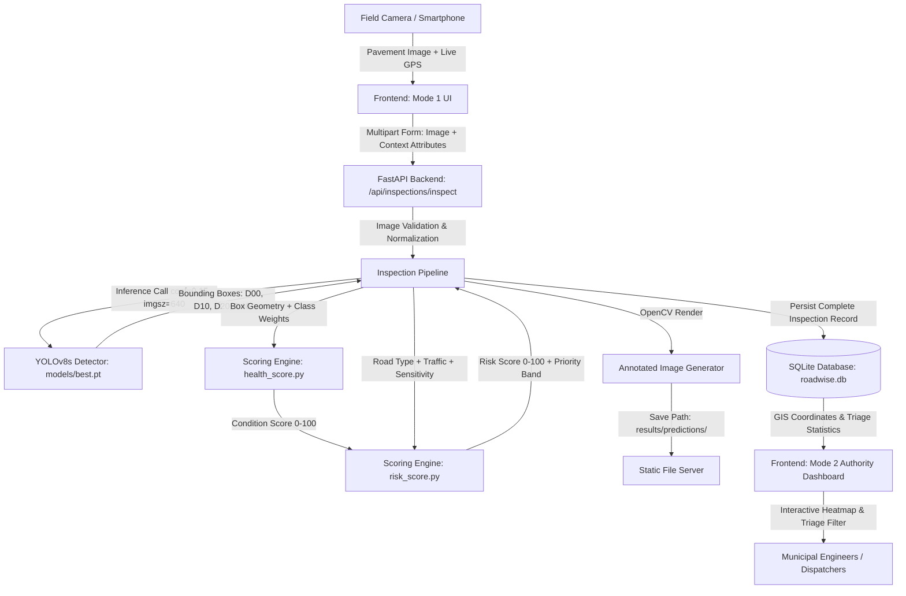
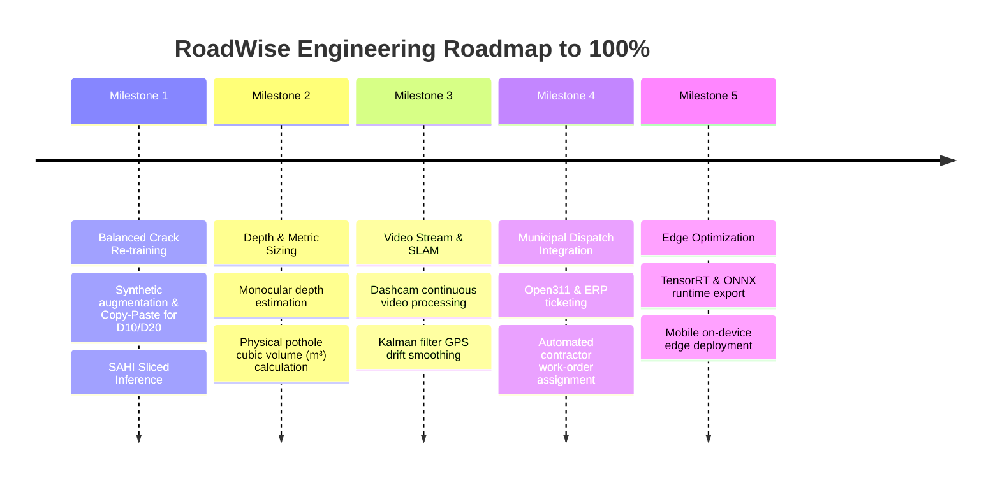

# RoadWise — Autonomous Civic Road Distress Detection, Health Telemetry & Maintenance-Prioritization Platform

[](#project-status--limitations)
[](#system-architecture)
[](#data-analysis--dataset-engineering)
[](#license)

> **RoadWise** is an end-to-end, AI-powered road condition assessment and municipal decision-support system. It transforms raw pavement photography into structured engineering telemetry, runs real-time defect detection using fine-tuned computer vision, calculates non-linear pavement condition indexes, and prioritizes civic repair dispatch through context-aware risk modeling.

---

## Master Project Documentation Suite

For comprehensive engineering breakdowns, faculty viva preparation, mathematical formulas, and codebase navigation, refer to the permanent documentation suite in [`docs/`](file:///c:/Users/aquad/OneDrive/Desktop/RoadWise/docs):

1. **[`docs/CODEBASE_MAP.md`](file:///c:/Users/aquad/OneDrive/Desktop/RoadWise/docs/CODEBASE_MAP.md)** — **Highest Priority:** Instant "Where is X?" navigation map covering every file, function, input, output, call-flow, and feature relationship across backend and frontend.
2. **[`docs/PROJECT_STATUS.md`](file:///c:/Users/aquad/OneDrive/Desktop/RoadWise/docs/PROJECT_STATUS.md)** — Permanent source of truth for project stage, completed/in-progress tasks, current models, test status, and next steps.
3. **[`docs/VIVA_CODE_GUIDE.md`](file:///c:/Users/aquad/OneDrive/Desktop/RoadWise/docs/VIVA_CODE_GUIDE.md)** — Practical viva preparation guide with code walkthroughs, 60-second pitches, ML concept defenses (IoU, mAP, D20 root causes), and 15 tough examiner Q&As.
4. **[`docs/SYSTEM_ARCHITECTURE.md`](file:///c:/Users/aquad/OneDrive/Desktop/RoadWise/docs/SYSTEM_ARCHITECTURE.md)** — Full architectural specification with Mermaid flowcharts, sequence diagrams, database schemas, and frontend component trees.
5. **[`docs/MODEL_EXPERIMENTS.md`](file:///c:/Users/aquad/OneDrive/Desktop/RoadWise/docs/MODEL_EXPERIMENTS.md)** — Complete machine learning history tracking `roadwise_v2`, Experiment A (3-class), Experiment C (2-class), and empirical D20 error analysis.
6. **[`docs/SCORING_METHODOLOGY.md`](file:///c:/Users/aquad/OneDrive/Desktop/RoadWise/docs/SCORING_METHODOLOGY.md)** — Complete mathematical derivations, numerical examples, overlap discounting algorithms, and context multiplier tables.

---

## Table of Contents
1. [Master Project Documentation Suite](#master-project-documentation-suite)
2. [Executive Summary & Purpose](#executive-summary--purpose)
3. [Current Project Status (The 80% Milestone)](#current-project-status-the-80-milestone)
4. [System Architecture & Workflow](#system-architecture--workflow)
5. [In-Depth Data Analysis & Dataset Engineering](#in-depth-data-analysis--dataset-engineering)
6. [Computer Vision & Model Detection Specs](#computer-vision--model-detection-specs)
7. [Why the Current Model Primarily Detects Potholes (The Asymmetry & Training Scope)](#why-the-current-model-primarily-detects-potholes-the-asymmetry--training-scope)
8. [Mathematical Scoring Engine](#mathematical-scoring-engine)
   - [Pavement Condition Score (Health Score)](#1-pavement-condition-score-health_scorepy)
   - [Risk Score & Maintenance Priority](#2-risk-score--maintenance-priority-risk_scorepy)
9. [Database Architecture & Schema](#database-architecture--schema)
10. [Comprehensive File & Directory Contribution Catalog](#comprehensive-file--directory-contribution-catalog)
11. [Frontend User Interfaces](#frontend-user-interfaces)
    - [Mode 1: Field Inspection Workspace](#mode-1-field-inspection-workspace)
    - [Mode 2: Authority Decision-Support Dashboard](#mode-2-authority-decision-support-dashboard)
12. [Current Limitations](#current-limitations)
13. [Roadmap to 100% Production Grade](#roadmap-to-100-production-grade)
14. [Installation & Setup Guide](#installation--setup-guide)
15. [API Reference](#api-reference)

---

## Executive Summary & Purpose

Traditional road infrastructure inspections suffer from four critical bottlenecks:
1. **Manual & Slow**: Municipalities rely on slow physical surveys or citizen complaints after severe road failure has already occurred.
2. **Subjective & Inconsistent**: Human visual assessments vary widely between different field inspectors.
3. **Context-Blind Scoring**: Traditional pothole tracking treats a pothole on an empty rural road identically to one outside a major hospital or school.
4. **Disorganized Records**: Survey imagery is often stored in disconnected folders without spatial indexing or actionable priority rankings.

**RoadWise solves this with a two-mode, closed-loop telemetry platform:**
* **Mode 1 (Field Inspection)**: Inspectors capture smartphone or dashcam photos with mandatory high-precision GPS geolocation. The system executes YOLOv8 object detection, maps damage categories, calculates damage severity, contextually multiplies risk, and persists a complete report to a relational database.
* **Mode 2 (Authority Dashboard)**: Municipal engineers and administrators visualize city-wide road networks via interactive geospatial heatmaps, analyze distress distributions, filter by urgency bands (`CRITICAL`, `HIGH`, `MEDIUM`, `LOW`), and inspect individual defect bounding boxes for immediate contractor dispatch.

---

## Current Project Status (The 80% Milestone)

| Area | Completion | Status / Implemented Capabilities |
|---|:---:|---|
| **Data Preprocessing & EDA** | **100%** | Full Pascal VOC to YOLO converter, XML schema validators, statistical distribution analyzers. |
| **Model Training & Fine-Tuning** | **80%** | Fine-tuned YOLOv8s on RDD2022 India dataset (mAP@50 = 67.65%). Potholes (`D40`) detect with high confidence; crack recall is currently limited by dataset sparsity. |
| **Mathematical Scoring Engine** | **100%** | Non-linear exponential decay condition scoring, intra-class overlap discounts, and context amplification risk matrices. |
| **Backend API (FastAPI)** | **100%** | REST endpoints for image upload, inference execution, statistics querying, static asset streaming, and SQLite storage. |
| **Mode 1 Frontend (Inspection)** | **100%** | Civic UI, drag-and-drop uploader, live browser GPS geolocation enforcement, dynamic telemetry results cards. |
| **Mode 2 Frontend (Authority)** | **95%** | Production-ready Authority Dashboard: Leaflet GIS map with priority markers, KPI cards, condition vs. risk charts, ranking tables, and deep-dive inspection modals. |
| **Edge & Video Stream Pipeline** | **20%** | Static image batch processing and experimental pavement ROI band cropping implemented; real-time video stream / RTSP input planned for 100% phase. |
| **Overall Project Maturity** | **~80%** | Fully operational working prototype with end-to-end telemetry and validated decision support. |

---

## System Architecture & Workflow



### End-to-End Workflow Steps:
1. **Capture & Telemetry Ingestion**: The field inspector uploads a pavement image. The browser requests high-accuracy live GPS (`navigator.geolocation.getCurrentPosition`) to pin exact latitude/longitude.
2. **Context Attribution**: The user specifies operational road metadata:
   - **Road Type** (e.g., Highway, Main Arterial, Residential, Colony Road).
   - **Traffic Volume** (Very High, High, Medium, Low, Very Low).
   - **Location Sensitivity** (Hospital, School, Emergency Route, Market, None).
3. **Computer Vision Inference**: FastAPI passes the image to `src/pipeline/inspection_pipeline.py`. Ultralytics YOLOv8 evaluates the frame, isolating bounding boxes, classification codes, and confidence probabilities.
4. **Condition Scoring**: `src/scoring/health_score.py` calculates the damage load based on box areas, class weights, and geometric overlap discounts.
5. **Contextual Risk Amplification**: `src/scoring/risk_score.py` amplifies the physical damage by the societal impact of the road's location, classifying the road into `CRITICAL`, `HIGH`, `MEDIUM`, or `LOW` maintenance priority.
6. **Annotation & Storage**: OpenCV generates a bounding-box annotated image. The full inspection record and each detection are stored with relational integrity in `data/roadwise.db`.
7. **Authority Visualization**: The Authority Dashboard aggregates city-wide records, displaying immediate triage rankings and map coordinates for road crews.

---

## In-Depth Data Analysis & Dataset Engineering

The RoadWise computer vision backbone was developed and analyzed using the **Crowdsensing-based Road Damage Detection Challenge (RDD2022)** dataset, focusing on the **India national subset**.

### 1. Exploratory Data Analysis (EDA) Results (`results/metrics/eda_summary_India.json`)

Our preprocessing audit evaluated **7,706 images** in the primary dataset:

| Metric | Measured Value | Implication / Engineering Takeaway |
|---|---|---|
| **Total Images Inspected** | **7,706** | Complete set of official raw survey images. |
| **Images With Zero Damage (Negatives)** | **3,921 (50.88%)** | Over half the dataset contains undamaged pavement, serving as natural background samples to prevent false-positive over-detection. |
| **Total Annotations Across All Classes** | **8,203** | Total labels in Pascal VOC XML files. |
| **Target Damage Class Annotations** | **6,831** | Filtered annotations for the 4 core structural distress types. |
| **Average Defects per Image** | **1.064** | Most damaged images contain 1 to 2 distinct defects. |
| **Maximum Defects in a Single Image** | **14** | Heavy failure areas exhibit clustered defects. |
| **Imbalance Ratio (Max / Min Class)** | **46.87x** | Extreme class disparity between potholes and transverse cracks. |

### 2. Class Distribution & The Training Split (`yolo_split_summary.json`)

The raw Pascal VOC XML labels were converted to YOLO coordinate format (`x_center, y_center, width, height` normalized to $[0, 1]$) with a reproducible seed (`seed=42`) using a 70/15/15 split:

```
Total Dataset: 7,706 Images
├── Train (70%): 5,394 Images (3,138 background images without damage)
├── Val   (15%): 1,155 Images (672 background images without damage)
└── Test  (15%): 1,157 Images (673 background images without damage)
```

#### Annotation Frequency per Target Class:

```
  D40 (Pothole):            ██████████████████████████████ 3,187 (46.7%)
  D20 (Alligator Crack):    ███████████████████ 2,021 (29.6%)
  D00 (Longitudinal Crack): ██████████████ 1,555 (22.8%)
  D10 (Transverse Crack):   █ 68 (1.0%)
```

### 3. Bounding Box Geometry Analysis (`results/metrics/bbox_stats_India.csv`)

Detailed geometric analysis reveals distinct physical footprints for each distress type:

| Distress Class | Code | Mean Box Width (px) | Mean Box Height (px) | Mean Relative Area (%) | Mean Aspect Ratio (W/H) |
|---|---|:---:|:---:|:---:|:---:|
| **Alligator Crack** | `D20` | 329.7 px | 165.3 px | **11.43%** | 2.06 |
| **Longitudinal Crack** | `D00` | 95.8 px | 131.7 px | **2.82%** | 0.80 |
| **Pothole** | `D40` | 120.2 px | 67.6 px | **2.29%** | 1.90 |
| **Transverse Crack** | `D10` | 247.6 px | 49.3 px | **2.59%** | **5.52** |

#### Key Analytical Insights:
* **Alligator Cracks (`D20`)** occupy the largest canvas footprint (~11.4% of frame area) with wide mesh patterns spanning both axes.
* **Transverse Cracks (`D10`)** exhibit extreme aspect ratios (average 5.52, maximum up to 11.14), appearing as razor-thin horizontal slivers.
* **Longitudinal Cracks (`D00`)** have aspect ratios below 1.0 (mean 0.80), tracking vertically along vehicle wheel paths.
* **Potholes (`D40`)** are relatively compact (~2.3% of the image) but possess high visual contrast.

---

## Computer Vision & Model Detection Specs

### Active Weights: `models/best.pt` (`roadwise_v2`)

* **Base Architecture**: YOLOv8s (Small — 11.2M parameters)
* **Training Device & Environment**: Trained on an external dedicated GPU workstation and subsequently integrated into RoadWise.
* **Dataset Scope (Important Note)**: 
  > ⚠️ **Dataset & Training Scope Note**: The newly integrated active model weights (`roadwise_v2` / `best.pt`) were trained using a **new dataset specifically focused on Potholes (`D40`)**. This model was **NOT trained on longitudinal cracks (`D00`), transverse cracks (`D10`), or alligator cracks (`D20`)**. As a result, the active deployed model currently detects potholes with high confidence and precision, but will not identify or flag crack distress types until the full 4-class balanced re-training is completed in the 100% project phase.
* **Training Epochs**: 83 (best checkpoint saved at **Epoch 53** via early stopping)
* **Validation Performance**:
  * **mAP@50**: **67.65%**
  * **Precision**: **66.4%**
  * **Recall**: **61.8%**
* **Inference Input Canvas**: 640x640 (dynamically supports up to 1920px)
* **Operational Confidence Threshold**: `conf=0.15` (calibrated to maximize defect recall in safety-critical civic inspections)

### Experimental Pavement Region-of-Interest (ROI) Detection

In addition to full-canvas inference, RoadWise contains an experimental road-focused ROI detector in `src/detection/roi_detect.py`:
1. **Horizon Stripping**: In standard dashcam/mobile footage, the upper 35% of the frame consists of sky, trees, buildings, and horizon where no pavement distress can occur.
2. **Crop Band**: The ROI focuses resolution on the road plane ($y \in [0.35, 1.00]$).
3. **Effective Density Gain**: Running 640px inference on a 65% crop increases effective pixel resolution per defect by **~1.54x**.
4. **Coordinate Mapping & Deduplication**: Bounding boxes detected within the crop are translated back to full-canvas coordinates and merged with full-image detections via Non-Maximum Suppression (IoU $\ge 0.45$).

---

## Why the Current Model Primarily Detects Potholes (The Asymmetry & Training Scope)

Field tests show that the current model detects potholes (`D40`) with high consistency, while longitudinal (`D00`), transverse (`D10`), and alligator (`D20`) cracks are not actively flagged. There are two direct causes:

### 1. The Active Model Was Trained Specifically for Potholes on a Changed Dataset
The model currently deployed in `models/best.pt` was trained on another device with a **new, updated dataset specifically curated for pothole detection**. Because it was not trained on annotated longitudinal, transverse, or alligator cracks, its feature extractor and prediction head are optimized exclusively for pothole surface cavities.

### 2. Historical Dataset Imbalance in the India RDD2022 Baseline
In the foundational RDD2022 India dataset analyzed during EDA (`eda_summary_India.json`):
* Potholes had **3,187 training instances**.
* Transverse cracks had only **68 instances** in the entire dataset (a **46.87-to-1 disadvantage**).
* Potholes present high photometric edge contrast, depth cavities, and interior shadows, whereas hairline cracks require dense micro-fissure annotations that were absent.

> **Target for 100% Project Completion**: We are targeting 100% coverage by retraining a unified multi-class YOLO model with balanced datasets and synthetic augmentation across all four damage classes (`D00`, `D10`, `D20`, `D40`).

---

## Mathematical Scoring Engine

The RoadWise scoring engine is deterministic, transparent, and mathematically grounded. It splits evaluation into **physical pavement condition** and **contextual societal risk**.

### 1. Pavement Condition Score (`health_score.py`)

Transforms raw bounding box detections from an image into a continuous condition index from **0.0 (total failure)** to **100.0 (pristine road)**:

$$\text{Damage Load} = \sum_{i \in \text{kept detections}} \left[ W(c_i) \times \text{conf}_i \times S(\text{area}_i, c_i) \times (1 - \text{Overlap}_i) \right]$$

$$\text{Condition Score} = 100 \times \exp\left(-\frac{\text{Damage Load}}{K}\right)$$

#### Constants & Parameters:
* **Steepness Constant ($K = 2.0$)**: Controls the exponential drop-off curve.
* **Class Hazard Weights ($W$)**:
  * Pothole (`D40`): **1.00** (immediate tire damage and vehicle rollover hazard)
  * Alligator Crack (`D20`): **0.80** (indicates sub-base structural water infiltration)
  * Longitudinal Crack (`D00`): **0.50** (surface joint fatigue)
  * Transverse Crack (`D10`): **0.50** (thermal contraction cracking)
* **Size Factor ($S$)**: Normalizes box area against the 90th-percentile reference area ($\text{AREA\_REF}$):
  $$\text{AREA\_REF} = \{ \text{D40}: 0.101, \text{D20}: 0.235, \text{D00}: 0.070, \text{D10}: 0.070 \}$$
  $$\text{Size Factor} = \min\left(1.0, \max\left(0.40, \frac{\text{width} \times \text{height}}{\text{AREA\_REF}(c)}\right)\right)$$
* **Confidence Threshold & Dynamic Synchronization**: The scoring threshold dynamically aligns with the detector's runtime confidence setting (`min_confidence = conf`, default baseline `0.10`). Any distress feature detected by the model during inference is directly included in the damage load rather than being dropped by a secondary hard threshold.
* **Intra-Class Overlap Discount**: If two bounding boxes of the *same* class overlap, the duplicate area is discounted so multiple overlapping detections of one pothole do not falsely penalize the score.

---

### 2. Risk Score & Maintenance Priority (`risk_score.py`)

Pavement distress cannot be prioritized purely by physical size. A moderate pothole on a 100 km/h expressway or outside a trauma hospital requires faster intervention than a large pothole on an unpaved farm access road.

$$\text{Risk Score} = \min\left(100.0, \, \text{Damage Level} \times \text{Context Multiplier}\right)$$

#### Step A: Stretched Damage Level
Because raw condition scores rarely drop below 30 in single-frame captures, damage is scaled against a reference threshold ($\text{DAMAGE\_REF} = 40.0$):
$$\text{Damage} = 100.0 - \text{Condition Score}$$
$$\text{Damage Level} = \min\left(100.0, \, \frac{\text{Damage}}{\text{DAMAGE\_REF}} \times 100.0\right)$$
*(A condition score $\le 60.0$ produces maximum physical Damage Level of 100).*

#### Step B: Context Factor ($\in [0.0, 1.0]$)
$$\text{Context Factor} = \frac{0.30 \times S_{\text{road}} + 0.30 \times S_{\text{traffic}} + 0.40 \times S_{\text{sensitivity}}}{100.0}$$

* **Road Type Scores ($S_{\text{road}}$)**: National Highway / Expressway (100), Hospital Road (85), Main Arterial (80), Residential (40), Village Road (25).
* **Traffic Scores ($S_{\text{traffic}}$)**: Very High (100), High (80), Medium (55), Low (30), Very Low (10).
* **Sensitivity Scores ($S_{\text{sensitivity}}$)**: Hospital / School / Emergency (100), Railway Station (85), Market Area (65), Residential (40), None (0).

#### Step C: Context Multiplier
$$\text{Context Multiplier} = 0.6 + (1.6 - 0.6) \times \text{Context Factor}$$
*(Ranges from $0.6\times$ for low-stakes deserted paths to $1.6\times$ for critical urban arterials).*

#### Step D: Maintenance Priority Classification
* **`CRITICAL`** ($\text{Risk Score} \ge 75$): Immediate emergency road crew dispatch required.
* **`HIGH`** ($50 \le \text{Risk Score} < 75$): Priority maintenance to be scheduled within 72 hours.
* **`MEDIUM`** ($25 \le \text{Risk Score} < 50$): Moderate wear; schedule routine maintenance.
* **`LOW`** ($\text{Risk Score} < 25$): Minor distress; continue passive monitoring.

#### Will Road Type & Nearby Area Give Different Scores?

| Dimension | Do Road Type & Nearby Area Affect It? | Why? |
|---|:---:|---|
| **Condition Score** | **NO** | Condition Score measures **pure physical road structural damage** (pothole depth/area, crack extent). Physical damage does not change whether the road is in an alley or a highway. |
| **Risk Score** | **YES (Significantly)** | Risk Score calculates **civic danger & repair urgency**. It multiplies physical damage by the **Context Factor** ($0.6\times$ up to $1.6\times$). |
| **Maintenance Priority** | **YES** | A defect in a high-consequence zone escalates the operational queue (e.g., jumping from `LOW` to `HIGH`). |

**Concrete Example (Identical Pothole, Condition Score = 85.0 $\rightarrow$ Damage Level = 37.5):**
* **Case 1: Quiet Village Road (No sensitive area)**:
  * Road Type: `village_road` (25), Traffic: `low` (30), Facility: `none` (0)
  * Context Multiplier: **$0.765\times$** $\implies$ **Risk Score = 28.7 (`LOW / MEDIUM`)**
* **Case 2: National Highway near a Trauma Hospital**:
  * Road Type: `national_highway` (100), Traffic: `high` (80), Facility: `hospital` (100)
  * Context Multiplier: **$1.54\times$** $\implies$ **Risk Score = 57.8 (`HIGH`)**

> **Design Principle**: Context *amplifies* damage; it does not fabricate it. If a road has zero detected damage ($\text{Damage Level} = 0$), its Risk Score remains **0.0 (`LOW`)** regardless of how sensitive the location is.

---

## Database Architecture & Schema

RoadWise uses an embedded, high-performance SQLite database (`data/roadwise.db`) with foreign key enforcement and indexed queries.

```sql
-- Main Inspections Table
CREATE TABLE IF NOT EXISTS inspections (
    id INTEGER PRIMARY KEY AUTOINCREMENT,
    report_id TEXT UNIQUE NOT NULL,             -- Unique UUID tag (e.g. RW-20261021-123456-ABCD)
    image_path TEXT,                            -- Relative path to uploaded original photo
    annotated_image_path TEXT,                  -- Relative path to rendered bounding box photo
    latitude REAL,                              -- Mandatory browser/EXIF GPS Latitude
    longitude REAL,                             -- Mandatory browser/EXIF GPS Longitude
    state TEXT,                                 -- Administrative state/region
    city TEXT,                                  -- City / municipality name
    area TEXT,                                  -- Specific neighborhood or roadway segment
    road_type TEXT,                             -- e.g. national_highway, residential, school_road
    traffic_level TEXT,                         -- very_high, high, medium, low, very_low
    location_sensitivity TEXT,                  -- hospital, school, market, none
    condition_score REAL,                       -- Pavement condition index (0.0 to 100.0)
    risk_score REAL,                            -- Final prioritized risk index (0.0 to 100.0)
    priority TEXT,                              -- CRITICAL | HIGH | MEDIUM | LOW
    recommendation TEXT,                        -- Automated engineering recommendation string
    pdf_path TEXT,                              -- Path to generated inspection report PDF
    created_at TIMESTAMP DEFAULT CURRENT_TIMESTAMP
);

-- Individual Defect Detections Table
CREATE TABLE IF NOT EXISTS detections (
    id INTEGER PRIMARY KEY AUTOINCREMENT,
    inspection_id INTEGER NOT NULL,             -- Foreign key referencing inspections(id)
    class_code TEXT NOT NULL,                   -- D00, D10, D20, D40
    class_name TEXT NOT NULL,                   -- Longitudinal Crack, Pothole, etc.
    confidence REAL NOT NULL,                   -- Detection confidence (0.0 to 1.0)
    x_center REAL,                              -- Normalized bounding box coordinates [0, 1]
    y_center REAL,
    width REAL,
    height REAL,
    FOREIGN KEY (inspection_id) REFERENCES inspections(id) ON DELETE CASCADE
);

-- Fast Lookup Indexes
CREATE INDEX IF NOT EXISTS idx_inspections_priority ON inspections(priority);
CREATE INDEX IF NOT EXISTS idx_inspections_city ON inspections(city);
CREATE INDEX IF NOT EXISTS idx_inspections_state ON inspections(state);
```

---

## Comprehensive File & Directory Contribution Catalog

```
RoadWise/
├── api/
│   ├── __init__.py                     # Marks api as an importable Python package
│   └── main.py                         # FastAPI web service; routes for inspection, dashboard stats, static mounts
├── data/
│   ├── roadwise.db                     # Primary SQLite production database
│   └── uploads/                        # Persistent storage for uploaded original field images
├── frontend/
│   ├── package.json                    # Frontend dependencies (React 19, Vite, TailwindCSS, Leaflet, Recharts)
│   ├── vite.config.js                  # Vite configuration and proxy setup
│   └── src/
│       ├── App.jsx                     # Root router managing Mode 1 (Inspection) and Mode 2 (Dashboard) navigation
│       ├── main.jsx                    # React DOM entry point
│       ├── index.css                   # Global Tailwind utilities and design system tokens
│       ├── api/
│       │   └── client.js               # Frontend API client adapter; handles endpoints and image URL resolution
│       ├── assets/
│       │   ├── hero_road_annotated.jpg # Real annotated sample image displayed in hero section
│       │   └── hero_road.jpg           # Clean sample road image
│       ├── components/
│       │   ├── ContextForm.jsx         # Telemetry input form with mandatory live GPS coordinate acquisition
│       │   ├── ImageUploader.jsx       # Drag-and-drop road photo uploader with preview and validation
│       │   ├── InspectionResults.jsx   # Results screen showing scores, detections table, and annotated image
│       │   ├── LoadingOverlay.jsx      # Animated radar/telemetry scanning indicator during inference
│       │   ├── Navbar.jsx              # Navigation header with system status indicators
│       │   ├── PriorityBadge.jsx       # Reusable color-coded badge for LOW/MEDIUM/HIGH/CRITICAL priorities
│       │   ├── ScoreGauge.jsx          # Circular SVG gauge visualizing Condition and Risk scores
│       │   └── Dashboard/
│       │       ├── GeographicMap.jsx   # Interactive Leaflet GIS map with color-coded priority pins
│       │       ├── MetricCards.jsx     # Authority telemetry cards (Total, Critical, High, Avg Condition)
│       │       ├── RankingTable.jsx    # Priority-sorted inspection table with search, filter, and pagination
│       │       └── InspectionDetailModal.jsx # Deep-dive inspection modal with side-by-side defect inspection
│       └── Pages/
│           ├── LandingPage.jsx         # Informational civic landing page explaining the RoadWise methodology
│           └── AuthorityDashboard.jsx  # Primary Mode 2 Authority triage and dispatch dashboard
├── models/
│   ├── best.pt                         # Active fine-tuned YOLOv8s model weights (roadwise_v2)
│   └── README.md                       # Model specifications, training epoch history, and class head specs
├── training_artifacts/
│   ├── args.yaml                       # Training hyperparameters and environment configuration
│   ├── results.csv                     # 83-epoch training & validation metrics log
│   └── data.yaml                       # Model 4-class dataset specification
├── results/
│   ├── metrics/
│   │   ├── eda_summary_India.json      # Complete statistical output of RDD2022 dataset audit
│   │   ├── bbox_stats_India.csv        # Bounding box geometry, aspect ratios, and area metrics
│   │   ├── yolo_split_summary.json     # Train/val/test split counts and per-class distribution
│   │   └── roi_baseline_comparison.csv # Baseline vs. high-res vs. ROI detection benchmark results
│   └── predictions/                    # Output directory where OpenCV saves annotated inspection photos
├── src/
│   ├── database/
│   │   └── database.py                 # SQLite database helper; table creation, insertions, queries, and stats
│   ├── detection/
│   │   ├── predict.py                  # Single-image inference driver; model caching and class mapping
│   │   ├── roi_detect.py               # Road-focused ROI crop inference and IoU deduplication
│   │   ├── batch_detect.py             # CLI batch processor for bulk folder inference
│   │   ├── calibrate_thresholds.py     # Grid search for optimal confidence and IoU thresholds
│   │   ├── evaluate_detection_methods.py # Side-by-side evaluator comparing Baseline, 960px, and ROI modes
│   │   └── evaluate_full_validation.py # Full validation set evaluator
│   ├── pipeline/
│   │   └── inspection_pipeline.py      # Master orchestrator connecting upload -> detect -> score -> db
│   ├── preprocessing/
│   │   ├── eda_rdd2022.py              # Script performing exploratory data analysis on Pascal VOC datasets
│   │   └── voc_to_yolo.py              # Pascal VOC XML to YOLO text format converter
│   └── scoring/
│       ├── health_score.py             # Exponential decay pavement condition calculation
│       ├── risk_score.py               # Context-amplified risk and maintenance priority calculation
│       └── validate_scoring.py         # Test harness verifying scoring edge cases and boundaries
├── requirements.txt                    # Python environment dependencies
└── setup_project.py                    # Workspace initialization directory builder
```

---

## Frontend User Interfaces

### Mode 1: Field Inspection Workspace
* **Enforced Geolocation**: Requires live browser GPS coordinates (`latitude` and `longitude`) before submission to ensure all defect reports are spatially grounded.
* **Smart Image Validation**: Checks format, aspect ratio, and minimum resolution before sending to the backend.
* **Full Telemetry Breakdown**:
  * Pavement Condition Gauge (0–100)
  * Societal Risk Gauge (0–100)
  * Severity Badging (`CRITICAL`, `HIGH`, `MEDIUM`, `LOW`)
  * Defect Breakdown Table listing individual bounding boxes, confidence values, and class codes.
  * Side-by-side view comparing original uploaded photography against the model-annotated output.

### Mode 2: Authority Decision-Support Dashboard
* **Geospatial GIS Map**: Integrated Leaflet map pinning all inspected roads across the city with interactive priority popups.
* **Civic Health Metric Cards**: High-level counters displaying Total Inspections, Critical Emergencies, High Priority Backlog, and Average Network Health.
* **Analytical Distributions**: Visual breakdown of condition scores across road types and traffic volumes.
* **Searchable Triage Table**: Sort inspections by risk score, filter by city or priority band, and launch inspection detail modals.
* **Inspection Modal**: View original and annotated imagery, inspect individual bounding boxes, and export inspection telemetry.

---

## Current Limitations

1. **Class Disparity in Training Data**: The model detects potholes (`D40`) with high accuracy, but longitudinal (`D00`), transverse (`D10`), and alligator (`D20`) cracks have lower recall due to the extreme 46.8x annotation scarcity in the training data.
2. **2D Monocular Limitation**: Camera imagery does not measure physical pothole depth in centimeters. Size is currently calculated as a normalized percentage of the camera frame rather than physical metric volume ($m^3$).
3. **Environmental Dependencies**: Image quality degrades under low-light night conditions, heavy rainfall, surface standing water reflections, or when pavement is obscured by fallen leaf debris.
4. **Single-Frame Temporal Limit**: Processing one image at a time cannot verify whether two photos taken 10 meters apart represent the same continuous road defect or two separate hazards.

---

## Roadmap to 100% Production Grade



### 1. Model Re-Training & Crack Balance (Next Step)
* **Synthetic Crack Augmentation**: Use generative and Copy-Paste augmentation to inject 5,000+ synthetic transverse (`D10`) and longitudinal (`D00`) crack samples into under-represented training splits.
* **Multi-Country Transfer Learning**: Incorporate the Japan and Czech subsets from RDD2022, which feature higher crack representation.
* **SAHI (Sliced Aided Hyper Inference)**: Implement overlapping sub-window sliding tiles to detect ultra-thin hairline cracks without downsampling distortion.

### 2. Metric Volume Estimation (Depth AI)
* Integrate lightweight monocular depth estimation models (e.g., MiDaS or Depth Anything) to measure real-world pothole depth in centimeters.
* Calculate estimated asphalt patch volume ($m^3$) and automated repair cost estimates ($/₹).

### 3. Continuous Video Stream & GPS Drift Smoothing
* Accept continuous MP4 video files and RTSP dashcam streams.
* Use ByteTRACK or DeepSORT to track individual road defects across frames, ensuring a defect that appears across 15 consecutive frames is counted only once.
* Apply Kalman filtering to smooth smartphone GPS jitter.

### 4. Municipal Dispatch & Civic Ticketing Integration
* Automated generation of standardized Open311 repair tickets.
* Automated contractor assignment and email alerts for `CRITICAL` safety hazards.
* Inspection re-visit verification workflow to confirm road repairs meet engineering standards.

---

## Installation & Setup Guide

### Prerequisites
* **Python**: 3.10, 3.11, or 3.12 (Python 3.14 recommended to avoid compilation issues)
* **Node.js**: v18.0.0 or higher
* **Git**

### 1. Clone the Repository
```bash
git clone https://github.com/adxi25/RoadWise.git
cd RoadWise
```

### 2. Backend Setup
```bash
# Create and activate a Python virtual environment
python -m venv venv

# On Windows:
.\venv\Scripts\activate

# On Linux/macOS:
source venv/bin/activate

# Install required dependencies
pip install -r requirements.txt
```

### 3. Frontend Setup
```bash
cd frontend
npm install
cd ..
```

### 4. Running the Complete System Locally

**Terminal 1 — Start the FastAPI Backend:**
```bash
# From project root with venv activated:
python -m uvicorn api.main:app --host 127.0.0.1 --port 8000 --reload
```

**Terminal 2 — Start the React/Vite Frontend:**
```bash
# From frontend/ directory:
cd frontend
npm run dev
```

* **Frontend UI**: [http://localhost:5173](http://localhost:5173)
* **Backend API Docs (Swagger UI)**: [http://127.0.0.1:8000/docs](http://127.0.0.1:8000/docs)
* **Backend Health Check**: [http://127.0.0.1:8000/api/health](http://127.0.0.1:8000/api/health)

---

## API Reference

### `POST /api/inspections/inspect`
Executes an end-to-end Mode 1 road inspection on an uploaded photo.

* **Request Type**: `multipart/form-data`
* **Parameters**:
  * `image` *(File, required)*: Road surface image (`.jpg`, `.png`, `.webp`).
  * `road_type` *(string, required)*: Road classification (e.g., `national_highway`, `main_road`, `residential`).
  * `traffic_level` *(string, required)*: `very_high`, `high`, `medium`, `low`, `very_low`.
  * `location_sensitivity` *(string, required)*: `hospital`, `school`, `emergency_service`, `market`, `none`.
  * `latitude` *(float, optional)*: GPS latitude (-90 to 90).
  * `longitude` *(float, optional)*: GPS longitude (-180 to 180).
  * `state` *(string, optional)*: State or Province name.
  * `city` *(string, optional)*: Municipality or City name.
  * `area` *(string, optional)*: Neighborhood or road corridor.
  * `conf` *(float, optional, default: 0.15)*: YOLO detection confidence threshold.
  * `imgsz` *(int, optional, default: 640)*: Inference canvas size.

* **Response Body (`201 Created`)**:
```json
{
  "report_id": "RW-20261021-123456-ABCD",
  "inspection_id": 42,
  "condition_score": 58.4,
  "risk_score": 78.2,
  "priority": "CRITICAL",
  "recommendation": "Immediate inspection and structural maintenance recommended.",
  "damage_level": 100.0,
  "context_factor": 0.78,
  "detections_count": 3,
  "detections": [
    {
      "class_code": "D40",
      "class_name": "Pothole",
      "confidence": 0.87,
      "box": [0.42, 0.78, 0.22, 0.14]
    }
  ],
  "image": {
    "original_path": "data/uploads/RW-20261021-123456-ABCD.jpg",
    "annotated_path": "results/predictions/RW-20261021-123456-ABCD_annotated.jpg"
  }
}
```

### `GET /api/dashboard/stats`
Returns aggregated statistical KPIs across all recorded inspections for the Authority Dashboard.

* **Response Body (`200 OK`)**:
```json
{
  "total_inspections": 36,
  "critical_count": 2,
  "high_count": 13,
  "medium_count": 6,
  "low_count": 15,
  "avg_condition_score": 88.5,
  "avg_risk_score": 32.1,
  "valid_gps_count": 16
}
```

### `GET /api/inspections`
Retrieves a paginated list of inspections with optional query filters for `priority`, `city`, and `state`.

### `GET /api/inspections/{inspection_id}`
Returns full record details and bounding boxes for a specific inspection.

---

## License

This project is licensed under the MIT License.
Developed for autonomous civic road maintenance prioritization and infrastructure decision-support.
