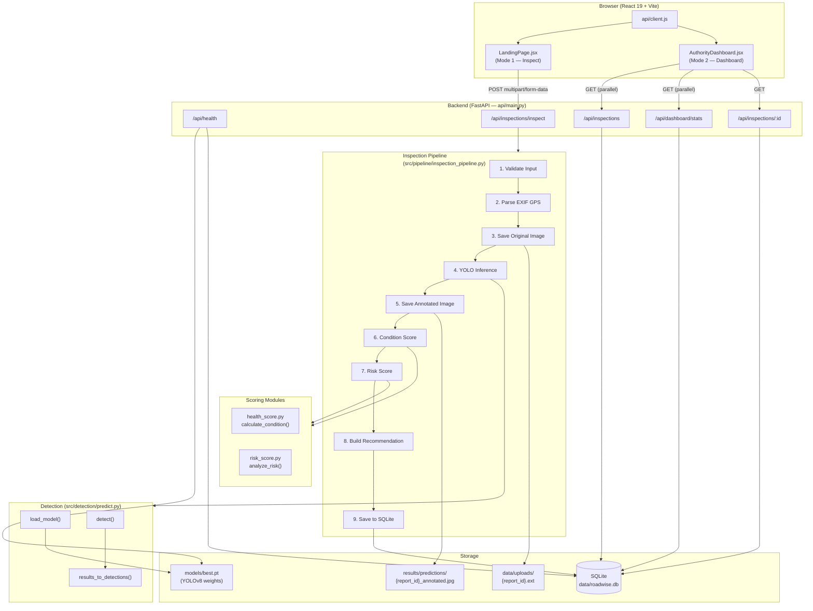
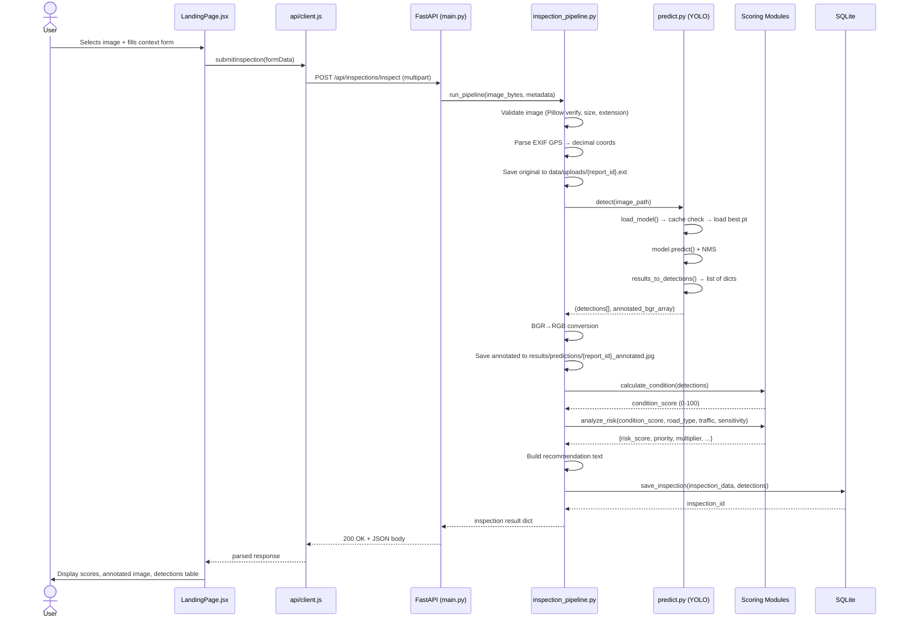
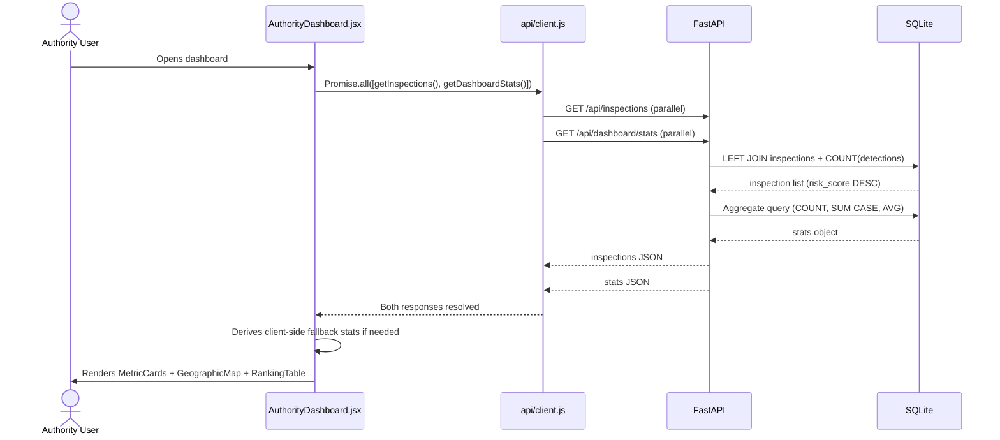
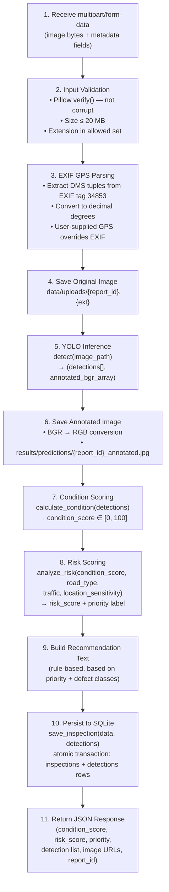
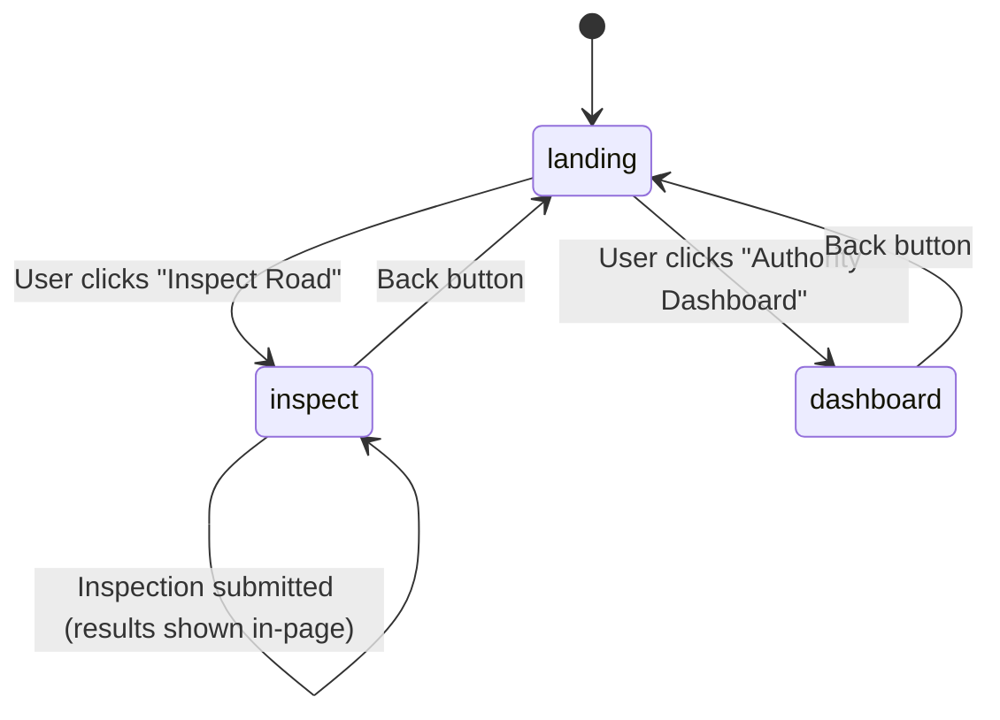

# RoadWise — System Architecture

> **Document Purpose:** Comprehensive technical architecture reference for the RoadWise road inspection system. Accurate to source code as of November 2026.

---

## Table of Contents

1. [High-Level Overview](#1-high-level-overview)
2. [Component Descriptions](#2-component-descriptions)
3. [API Endpoints](#3-api-endpoints)
4. [Request / Response Flow](#4-request--response-flow)
5. [Inspection Pipeline](#5-inspection-pipeline)
6. [Detection Module](#6-detection-module)
7. [Scoring Algorithms](#7-scoring-algorithms)
8. [Database Layer](#8-database-layer)
9. [Frontend Architecture](#9-frontend-architecture)
10. [Key Data Structures](#10-key-data-structures)
11. [Important Dependencies](#11-important-dependencies)

---

## 1. High-Level Overview

RoadWise is a full-stack road-condition assessment application. A user uploads a road photograph along with contextual metadata (location, road type, traffic level). The backend runs a YOLOv8 object-detection model to identify pavement defects, scores the road's health and risk, persists the results to SQLite, and returns a structured JSON report. A React dashboard lets authorities browse all recorded inspections on a Leaflet map and view aggregate KPIs.

### Tech Stack at a Glance

| Layer | Technology |
|---|---|
| Backend API | Python 3, FastAPI |
| AI / Detection | YOLOv8 (Ultralytics), PyTorch |
| Image Handling | Pillow |
| Database | SQLite 3 (via stdlib `sqlite3`) |
| Frontend | React 19, Vite, Tailwind CSS |
| Mapping | Leaflet.js |
| HTTP Client | Axios / Fetch |

### Architecture Diagram



---

## 2. Component Descriptions

### 2.1 Backend Entry Point — `api/main.py`

The FastAPI application object is defined here. Key responsibilities:

- **Lifespan context manager** — calls `create_tables()` from `src/database/database.py` on startup, ensuring the SQLite schema is in place before any request is served.
- **Static file mounts** — serves uploaded originals at `/data/uploads` and annotated predictions at `/results/predictions`, so the frontend can display images via URL.
- **CORS middleware** — allows requests from `http://localhost:5173` (Vite dev server) and `http://localhost:4173` (Vite preview build). Credentials and all HTTP methods/headers are permitted.
- **Route registration** — five endpoints (detailed in §3).

### 2.2 Inspection Pipeline — `src/pipeline/inspection_pipeline.py`

Orchestrates the end-to-end processing of a single inspection request. See §5 for the full 11-step walkthrough.

### 2.3 Detection Module — `src/detection/predict.py`

Wraps the Ultralytics YOLOv8 API. Uses a module-level `_model_cache` dict for lazy, one-time model loading. See §6 for detail.

### 2.4 Scoring Modules

| File | Function | Output |
|---|---|---|
| `src/scoring/health_score.py` | `calculate_condition(detections)` | `condition_score` ∈ [0, 100] |
| `src/scoring/risk_score.py` | `analyze_risk(health_score, road_type, traffic, location_sensitivity)` | risk dict with `risk_score` and `priority` |

### 2.5 Database Layer — `src/database/database.py`

Pure `sqlite3` — no ORM. Provides six public functions: `get_connection`, `create_tables`, `save_inspection`, `get_all_inspections`, `get_inspection`, `get_inspection_stats`. See §8.

### 2.6 Frontend — `frontend/src/`

React 19 SPA built with Vite. Two primary pages wired through `App.jsx`. See §9 for the component tree.

---

## 3. API Endpoints

All endpoints are prefixed with `/api`.

| Method | Path | Description |
|---|---|---|
| `GET` | `/api/health` | Liveness + readiness check |
| `POST` | `/api/inspections/inspect` | Submit a road image for inspection |
| `GET` | `/api/inspections` | List all inspections (filterable) |
| `GET` | `/api/inspections/{id}` | Single inspection with detections |
| `GET` | `/api/dashboard/stats` | Aggregate KPI statistics |

### `GET /api/health`

Performs three checks in sequence:
1. Model weights file `models/best.pt` exists on disk.
2. SQLite database is reachable (connects and closes successfully).
3. YOLO model can be loaded without error (calls `load_model()`).

Returns `200 OK` with a status payload if all checks pass, or an appropriate error code otherwise.

### `POST /api/inspections/inspect`

**Content-Type:** `multipart/form-data`

| Field | Type | Required | Notes |
|---|---|---|---|
| `image` | `UploadFile` | ✅ | JPEG/PNG/WEBP; max 20 MB |
| `road_type` | `str` | ✅ | e.g., `highway`, `urban`, `rural` |
| `traffic_level` | `str` | ✅ | e.g., `low`, `medium`, `high` |
| `location_sensitivity` | `str` | ✅ | e.g., `normal`, `sensitive` |
| `latitude` | `float` | ❌ | Overrides EXIF if provided |
| `longitude` | `float` | ❌ | Overrides EXIF if provided |
| `state` | `str` | ❌ | |
| `city` | `str` | ❌ | |
| `area` | `str` | ❌ | |

Returns full inspection JSON (see §10.2).

### `GET /api/inspections`

Query parameters for filtering:

| Param | Description |
|---|---|
| `priority` | Filter by priority label (`LOW`, `MEDIUM`, `HIGH`, `CRITICAL`) |
| `city` | Filter by city name |
| `road_type` | Filter by road type |
| `limit` | Maximum number of results to return |

Results are ordered by `risk_score DESC`.

### `GET /api/inspections/{id}`

Returns one inspection record joined with its full list of detection rows.

### `GET /api/dashboard/stats`

Single-pass aggregate query returning:
- Total inspection count
- Count breakdown by priority (CRITICAL, HIGH, MEDIUM, LOW)
- Average condition score across all inspections

---

## 4. Request / Response Flow

### Mode 1 — Road Inspection (Citizen / Field Agent)



### Mode 2 — Authority Dashboard



---

## 5. Inspection Pipeline

**File:** `src/pipeline/inspection_pipeline.py`

The pipeline is a sequential 11-step procedure executed for every `POST /api/inspections/inspect` request.



### Step 3 — EXIF GPS Parsing (DMS → Decimal)

EXIF stores GPS as degrees-minutes-seconds (DMS) rational tuples. The pipeline converts to decimal:

```
decimal = degrees + (minutes / 60) + (seconds / 3600)
```

The hemisphere reference (`N`/`S`, `E`/`W`) is applied by negating the value for `S` and `W`. If the user explicitly supplies `latitude`/`longitude` form fields, those values **take precedence** over any EXIF data.

---

## 6. Detection Module

**File:** `src/detection/predict.py`

### `load_model()`

Implements lazy loading with a module-level cache dict `_model_cache`. On first call it loads `models/best.pt` via the Ultralytics API and stores the model object under a fixed key. Subsequent calls return the cached instance immediately, avoiding repeated disk I/O on each request.

```python
# Conceptual structure
_model_cache = {}

def load_model():
    if "model" not in _model_cache:
        _model_cache["model"] = YOLO("models/best.pt")
    return _model_cache["model"]
```

### `detect(image_path)`

1. Calls `load_model()` to obtain the cached YOLO instance.
2. Calls `model.predict(image_path)` — NMS is applied internally by Ultralytics.
3. Calls `results_to_detections()` to convert raw tensors to Python dicts.
4. Returns a 2-tuple: `(detections_list, annotated_bgr_numpy_array)`.

### `results_to_detections(ultralytics_results)`

Iterates over detected bounding boxes and converts each to a Python dict (see §10.1). All spatial values are **normalized to [0, 1]** relative to image dimensions.

**Class name normalization:** The model head outputs either D-code labels (`D00`, `D10`, `D20`, `D40`) or English-language names. This function maps both representations to the canonical D-code form for consistent downstream processing.

### Model Details

| Property | Value |
|---|---|
| Weights file | `models/best.pt` |
| Architecture | YOLOv8 |
| Number of classes | 4 |
| Class labels | D00 (Longitudinal crack), D10 (Transverse crack), D20 (Alligator crack), D40 (Pothole) |

---

## 7. Scoring Algorithms

### 7.1 Condition Score — `src/scoring/health_score.py`

**Function:** `calculate_condition(detections) → float`

The condition score represents the structural health of the road surface on a scale of **0 (worst) to 100 (best)**.

**Algorithm:**

For each detection, a *severity weight* is assigned based on defect class (potholes are weighted more heavily than hairline cracks). An *overlap penalty* `(1 - overlap)` discounts detections that significantly overlap an already-counted area.

```
damage_load = Σ [ severity(class_i) × (1 - overlap_i) ]   for all detections i

condition_score = 100 × exp( −damage_load / 2.0 )
```

- If `detections` is empty → `damage_load = 0` → `condition_score = 100`.
- As `damage_load` increases, the score decays exponentially toward 0.
- The divisor `2.0` controls the decay rate.

### 7.2 Risk Score — `src/scoring/risk_score.py`

**Function:** `analyze_risk(health_score, road_type, traffic, location_sensitivity) → dict`

Converts a health score to an actionable risk level by applying a contextual multiplier.

```
damage_level = 100 − health_score

multiplier = f(road_type, traffic, location_sensitivity)   where multiplier ∈ [0.6, 1.6]

risk_score = damage_level × multiplier
```

**Priority thresholds:**

| Priority | Condition |
|---|---|
| `CRITICAL` | `risk_score ≥ 75` |
| `HIGH` | `risk_score ≥ 50` |
| `MEDIUM` | `risk_score ≥ 25` |
| `LOW` | `risk_score < 25` |

The multiplier is highest for high-traffic highways near sensitive locations (schools, hospitals) and lowest for low-traffic rural roads.

The returned dict includes `risk_score`, `priority`, and the intermediate `multiplier` value used.

---

## 8. Database Layer

**File:** `src/database/database.py`  
**DB file:** `data/roadwise.db`

### Schema

```sql
-- Parent table: one row per inspection
CREATE TABLE inspections (
    id                    INTEGER PRIMARY KEY AUTOINCREMENT,
    report_id             TEXT    UNIQUE NOT NULL,       -- UUID assigned by pipeline
    image_path            TEXT,                          -- served by /data/uploads/
    annotated_image_path  TEXT,                          -- served by /results/predictions/
    latitude              REAL,
    longitude             REAL,
    state                 TEXT,
    city                  TEXT,
    area                  TEXT,
    road_type             TEXT,
    traffic_level         TEXT,
    location_sensitivity  TEXT,
    condition_score       REAL,
    risk_score            REAL,
    priority              TEXT,                          -- LOW/MEDIUM/HIGH/CRITICAL
    recommendation        TEXT,
    pdf_path              TEXT,
    created_at            TEXT DEFAULT CURRENT_TIMESTAMP
);

-- Child table: one row per detected defect
CREATE TABLE detections (
    id            INTEGER PRIMARY KEY AUTOINCREMENT,
    inspection_id INTEGER NOT NULL
                  REFERENCES inspections(id) ON DELETE CASCADE,
    class_code    TEXT,     -- D00 / D10 / D20 / D40
    class_name    TEXT,     -- human-readable label
    confidence    REAL,     -- 0.0 – 1.0
    x_center      REAL,     -- normalized [0,1]
    y_center      REAL,     -- normalized [0,1]
    width         REAL,     -- normalized [0,1]
    height        REAL      -- normalized [0,1]
);
```

> [!NOTE]
> `PRAGMA foreign_keys = ON` is set on every connection via `get_connection()`, ensuring `ON DELETE CASCADE` from `inspections` to `detections` is enforced.

### Indexes

Five indexes are created by `create_tables()` to accelerate common query patterns:

| Index | Column(s) | Purpose |
|---|---|---|
| `idx_priority` | `inspections.priority` | Filter by priority label |
| `idx_state` | `inspections.state` | Filter by state |
| `idx_city` | `inspections.city` | Filter by city |
| `idx_latlon` | `(inspections.latitude, inspections.longitude)` | Geographic proximity queries |
| `idx_det_inspection` | `detections.inspection_id` | JOIN performance |

### Public Functions

| Function | Description |
|---|---|
| `get_connection()` | Opens SQLite connection; sets `PRAGMA foreign_keys = ON` |
| `create_tables()` | Creates tables + indexes if not exist; called at startup |
| `save_inspection(data, detections)` | Atomic transaction: inserts `inspections` row then all `detections` rows |
| `get_all_inspections(priority, city, road_type, limit)` | LEFT JOIN with detection count; ordered `risk_score DESC` |
| `get_inspection(id)` | Single inspection row + all its detection rows |
| `get_inspection_stats()` | Single-pass aggregate: COUNT, SUM CASE per priority, AVG condition_score |

> [!TIP]
> `save_inspection()` uses a single transaction (begin → insert inspections → insert all detections → commit) so a mid-write failure leaves no orphan rows.

---

## 9. Frontend Architecture

**Entry:** `frontend/src/main.jsx` → `App.jsx`

### Mode State Machine

`App.jsx` manages a top-level `mode` state with three values:



### Component Tree

```
App.jsx  (mode: landing | inspect | dashboard)
├── Pages/LandingPage.jsx          (mode = landing | inspect)
│   ├── components/ImageUploader   Upload widget; preview; drag-and-drop
│   ├── components/ContextForm     Road type, traffic, sensitivity, manual GPS
│   └── components/InspectionResults  (shown after submission)
│       ├── components/ScoreGauge      Animated arc gauge (condition_score)
│       ├── components/PriorityBadge   Colour-coded priority label
│       └── <detection table>          Lists each defect with confidence
│
└── Pages/AuthorityDashboard.jsx   (mode = dashboard)
    ├── components/MetricCards     KPI tiles: total, critical, avg score, …
    ├── components/GeographicMap   Leaflet.js map; pins coloured by priority
    ├── components/RankingTable    Sortable table of inspections
    └── components/InspectionDetailModal  Full record on row click
```

### Data Fetching — `AuthorityDashboard.jsx`

The dashboard fires both API calls **in parallel** using `Promise.all`:

```js
const [inspections, stats] = await Promise.all([
    getInspections(),       // GET /api/inspections
    getDashboardStats()     // GET /api/dashboard/stats
]);
```

If the stats endpoint fails or returns incomplete data, the component **derives stats client-side** from the inspections array as a fallback, ensuring the UI never shows blank KPI cards.

### `frontend/src/api/client.js`

Centralised HTTP layer wrapping Axios (or Fetch). Exports one function per API endpoint (`submitInspection`, `getInspections`, `getDashboardStats`, `getInspectionById`). All callers import from this module; no component talks to the network directly.

---

## 10. Key Data Structures

### 10.1 Detection Dict (returned by `results_to_detections()`)

```json
{
  "class_code":  "D40",
  "class_name":  "Pothole",
  "confidence":  0.87,
  "x_center":    0.512,
  "y_center":    0.634,
  "width":       0.143,
  "height":      0.098
}
```

> [!IMPORTANT]
> All spatial fields (`x_center`, `y_center`, `width`, `height`) are **normalized to [0, 1]** relative to the full image dimensions. To get pixel coordinates multiply by `image_width` / `image_height` respectively.

**Defect class reference:**

| `class_code` | `class_name` | Description |
|---|---|---|
| `D00` | Longitudinal Crack | Crack running parallel to road direction |
| `D10` | Transverse Crack | Crack running perpendicular to road direction |
| `D20` | Alligator Crack | Network of interconnected cracks (fatigue) |
| `D40` | Pothole | Bowl-shaped hole in the surface |

### 10.2 Inspection Response JSON (from `POST /api/inspections/inspect`)

```json
{
  "report_id":             "a3f8c1d2-...",
  "condition_score":       62.4,
  "risk_score":            47.1,
  "priority":              "HIGH",
  "recommendation":        "Schedule repair within 2 weeks. Potholes detected on a high-traffic road.",
  "image_url":             "/data/uploads/a3f8c1d2-....jpg",
  "annotated_image_url":   "/results/predictions/a3f8c1d2-..._annotated.jpg",
  "latitude":              28.6139,
  "longitude":             77.2090,
  "state":                 "Delhi",
  "city":                  "New Delhi",
  "area":                  "Connaught Place",
  "road_type":             "urban",
  "traffic_level":         "high",
  "location_sensitivity":  "sensitive",
  "detections": [
    {
      "class_code": "D40",
      "class_name": "Pothole",
      "confidence": 0.87,
      "x_center": 0.512,
      "y_center": 0.634,
      "width": 0.143,
      "height": 0.098
    }
  ],
  "created_at": "2026-11-11T17:24:25Z"
}
```

### 10.3 Dashboard Stats Response (from `GET /api/dashboard/stats`)

```json
{
  "total_inspections": 55,
  "critical_count":     8,
  "high_count":        17,
  "medium_count":      22,
  "low_count":          8,
  "avg_condition_score": 61.3
}
```

---

## 11. Important Dependencies

### Backend (`requirements.txt` / `pyproject.toml`)

| Package | Version (approx.) | Role |
|---|---|---|
| `fastapi` | 0.110+ | Web framework & routing |
| `uvicorn` | 0.29+ | ASGI server |
| `python-multipart` | 0.0.9+ | Parsing `multipart/form-data` |
| `ultralytics` | 8.x | YOLOv8 model API |
| `torch` / `torchvision` | 2.x | PyTorch backend for YOLO |
| `Pillow` | 10.x | Image loading, verification, EXIF parsing |
| `numpy` | 1.26+ | Array operations (BGR→RGB conversion) |

### Frontend (`package.json`)

| Package | Version (approx.) | Role |
|---|---|---|
| `react` | 19.x | UI framework |
| `react-dom` | 19.x | DOM renderer |
| `vite` | 5.x | Build tool & dev server (port 5173) |
| `tailwindcss` | 3.x | Utility-first CSS |
| `axios` | 1.x | HTTP client (api/client.js) |
| `leaflet` | 1.9+ | Interactive map (GeographicMap component) |
| `react-leaflet` | 4.x | React bindings for Leaflet |

### Runtime File Locations

| Path | Contents |
|---|---|
| `models/best.pt` | Trained YOLOv8 weights (4-class pavement defect model) |
| `data/roadwise.db` | SQLite database (55 inspections, 100 detections as of Nov 2026) |
| `data/uploads/` | Original uploaded road images, named by `report_id` |
| `results/predictions/` | YOLO-annotated images, named `{report_id}_annotated.jpg` |

---

> [!NOTE]
> This document was generated from direct source-code inspection of the RoadWise repository. All function names, file paths, formulas, and schema definitions reflect the actual implementation.
