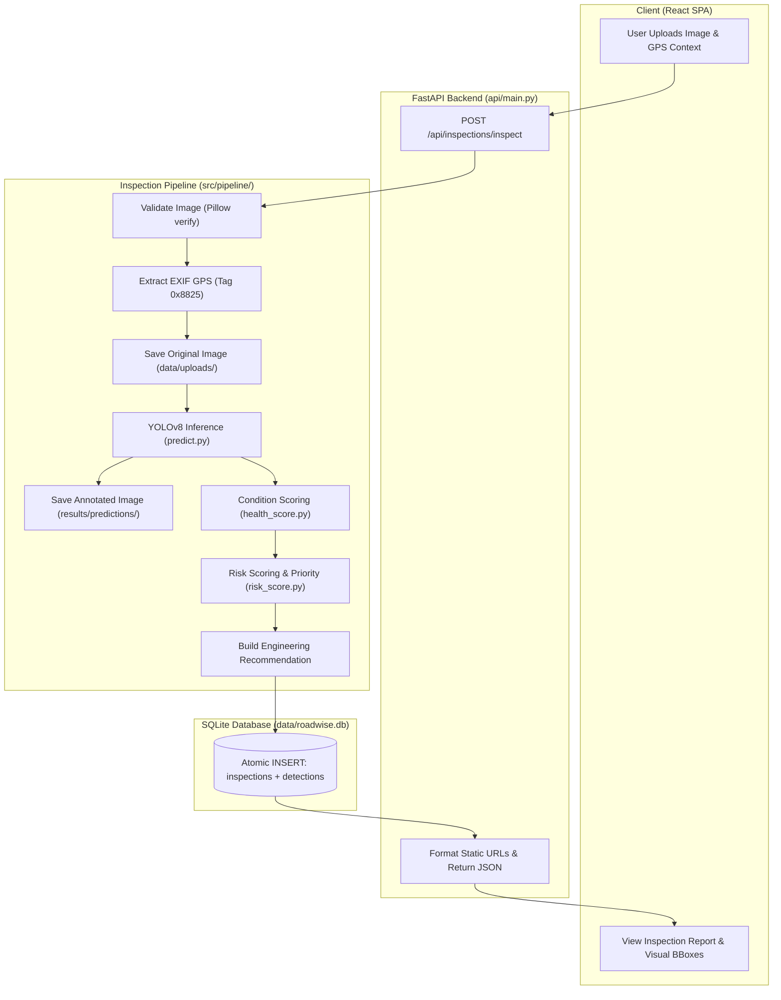
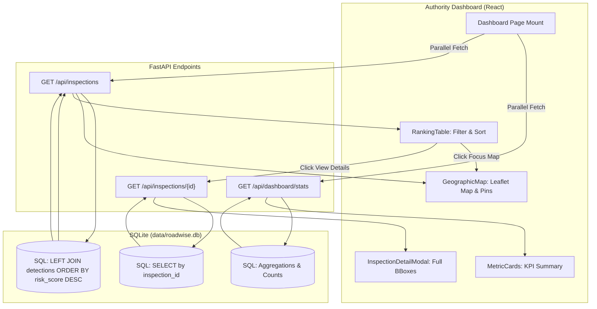

# RoadWise — Comprehensive Codebase & Architecture Manual

> **Document Version:** 1.0.0  
> **Target Audience:** Engineering Leads, Academic Viva Examiners, BTech CSE Students, Full-Stack Developers  
> **System Status:** Production Prototype Stabilized  

---

## 1. System Overview & Dual-Mode Architecture

RoadWise is an AI-powered road distress inspection and infrastructure maintenance-prioritization platform. Designed for smart cities, public works departments, and highway authorities, RoadWise bridges computer vision road-surface diagnostics with civil maintenance decision-making.

The system is organized into two primary operating modes:

```
+---------------------------------------------------------------------------------------------------+
|                                      ROADWISE SYSTEM MODES                                        |
+-------------------------------------------------+-------------------------------------------------+
|          MODE 1: ROAD INSPECTION                |         MODE 2: AUTHORITY DASHBOARD             |
+-------------------------------------------------+-------------------------------------------------+
| - Citizen / Inspector uploads road photograph.  | - Municipal highway maintenance dashboard.      |
| - EXIF GPS extracted (or manual GPS entered).   | - Fetches all historical inspections from DB.   |
| - YOLOv8 detects 4 damage classes.              | - Aggregates fleet KPIs (Critical/High/Avg).    |
| - Condition Score computed (0-100).             | - Interactive GIS map with priority markers.    |
| - Risk Score & Maintenance Priority calculated. | - Multi-attribute ranking & filtering table.   |
| - Results persisted atomically to SQLite.       | - Deep-dive inspection inspection modal.        |
+-------------------------------------------------+-------------------------------------------------+
```

---

## 2. Mode 1: Road Inspection End-to-End Pipeline

Mode 1 processes an individual road inspection from raw image bytes to an actionable civil engineering report.

### Step-by-Step Execution Sequence

1. **Client Submission (`frontend/src/App.jsx` -> `api/client.js`)**
   - The user selects or drags a road photograph (`.jpg`, `.jpeg`, `.png`, `.webp`).
   - The user inputs or captures GPS coordinates (mandatory in UI).
   - Operational context is specified: Road Type (`national_highway`, `main_road`, `residential`, etc.), Traffic Level (`very_high`, `high`, `medium`, `low`, `very_low`), and Location Sensitivity (`school`, `hospital`, `market`, `none`, etc.).
   - Hyperparameters: Confidence threshold ($conf$, default 0.25) and inference image size ($imgsz$, default 640).
   - Payload is packaged as `multipart/form-data` and posted to `POST /api/inspections/inspect`.

2. **HTTP Serialization & Validation (`api/main.py`)**
   - FastAPI receives the multipart stream.
   - Image bytes are read into memory.
   - Form parameters are validated against boundary constraints ($conf \in [0.05, 0.95]$, $imgsz \in [320, 1920]$).
   - `run_inspection()` in `src/pipeline/inspection_pipeline.py` is invoked.

3. **Image & File Integrity Validation (`src/pipeline/inspection_pipeline.py:validate_image_bytes`)**
   - File size verified against maximum allowable ceiling (20 MB).
   - Pillow (`PIL.Image.open(io.BytesIO(bytes))`) reads headers and runs `.verify()`.
   - Dimensions verified ($width \ge 64$ px, $height \ge 64$ px).

4. **EXIF GPS Metadata Extraction (`src/pipeline/inspection_pipeline.py:extract_gps`)**
   - Extracts EXIF IFD tag `0x8825` (GPSInfo).
   - Parses latitude and longitude Degrees, Minutes, Seconds (DMS) rational tuples:
     $$\text{DecimalDegrees} = \text{Degrees} + \frac{\text{Minutes}}{60.0} + \frac{\text{Seconds}}{3600.0}$$
   - Hemispheric reference inversion ('S' -> negative latitude, 'W' -> negative longitude).
   - User-supplied GPS coordinates take precedence if already provided.

5. **Original Image Storage (`data/uploads/`)**
   - Report ID generated: `RW-YYYYMMDD-HHMMSS-XXXX` (using timestamp + 4-char UUID hex).
   - Raw bytes saved to `data/uploads/{report_id}.jpg` for evidentiary auditability.

6. **YOLOv8 Damage Detection (`src/detection/predict.py:detect`)**
   - Loads cached model weights (`models/best.pt`, YOLOv8s).
   - Pre-processes image (letterbox resize with aspect ratio preservation, BGR to RGB, normalization).
   - Runs forward inference with Non-Maximum Suppression (NMS).
   - Returns detection dictionaries:
     $$\{class\_id, class\_code, class\_name, confidence, [x_{min}, y_{min}, x_{max}, y_{max}], [x_c, y_c, w, h]\}$$
   - Generates OpenCV BGR annotated image with bounding boxes, labels, and confidence overlays.

7. **Annotated Image Storage (`results/predictions/`)**
   - BGR numpy array converted to RGB (`annotated[:, :, ::-1]`).
   - Saved via Pillow as high-quality JPEG at `results/predictions/{report_id}_annotated.jpg`.

8. **Road Condition Scoring (`src/scoring/health_score.py:calculate_condition`)**
   - Filters detections where $confidence \ge min\_confidence$.
   - Computes weighted area penalty deductions and defect count penalties.
   - Outputs `condition_score` $\in [0.0, 100.0]$ and severity band (`GOOD`, `FAIR`, `POOR`, `CRITICAL`).

9. **Risk Scoring & Maintenance Priority (`src/scoring/risk_score.py:analyze_risk`)**
   - Converts condition score to stretched `damage_level` $\in [0.0, 100.0]$.
   - Synthesizes `context_factor` $\in [0.0, 1.0]$ from road type, traffic, and sensitivity.
   - Multiplies damage by context multiplier $[0.6, 1.6]$.
   - Categorizes final `maintenance_priority` into `CRITICAL`, `HIGH`, `MEDIUM`, or `LOW`.

10. **Actionable Recommendation Engine (`build_recommendation`)**
    - Constructs human-readable engineering narrative summarizing detected defects and prescribed urgency.

11. **Relational Database Persistence (`src/database/database.py:save_inspection`)**
    - Opens SQLite connection with `PRAGMA foreign_keys = ON`.
    - Inserts inspection record into `inspections` table.
    - Atomically inserts each bounding box into `detections` table referencing `inspection_id`.
    - Commits transaction; rolls back on any error.

12. **Client Response Serialization**
    - Normalizes local file paths to static web mounts (`data/uploads/...`, `results/predictions/...`).
    - Returns HTTP 201 Created with complete structured JSON payload.
    - React renders `<InspectionResults />` with interactive defect breakdown.

---

## 3. Mode 1 Architecture Flowchart (Mermaid)



---

## 4. Mode 2: Authority Maintenance Dashboard End-to-End Pipeline

Mode 2 empowers road authorities to analyze macro-level infrastructure conditions across regions, filter by risk, and direct maintenance tenders.

### Step-by-Step Execution Sequence

1. **Dashboard Initialization (`frontend/src/Pages/AuthorityDashboard.jsx`)**
   - On component mount, fires parallel requests via `Promise.all`:
     - `GET /api/inspections` (fetch all past inspection records).
     - `GET /api/dashboard/stats` (fetch server-side aggregated metrics).
   - If `stats` request fails, a client-side fallback calculates KPIs dynamically from the inspections array.

2. **Backend Aggregation Queries (`src/database/database.py`)**
   - `get_inspection_stats()` executes optimized SQL aggregation:
     ```sql
     SELECT 
         COUNT(*) AS total_inspections,
         SUM(CASE WHEN UPPER(priority) = 'CRITICAL' THEN 1 ELSE 0 END) AS critical_count,
         SUM(CASE WHEN UPPER(priority) = 'HIGH' THEN 1 ELSE 0 END) AS high_count,
         SUM(CASE WHEN UPPER(priority) = 'MEDIUM' THEN 1 ELSE 0 END) AS medium_count,
         SUM(CASE WHEN UPPER(priority) = 'LOW' THEN 1 ELSE 0 END) AS low_count,
         AVG(condition_score) AS avg_condition_score,
         AVG(risk_score) AS avg_risk_score,
         SUM(CASE WHEN latitude IS NOT NULL AND longitude IS NOT NULL THEN 1 ELSE 0 END) AS valid_gps_count
     FROM inspections;
     ```
   - `get_all_inspections()` executes left join with `detections` to count bounding boxes per road:
     ```sql
     SELECT i.*, COUNT(d.id) AS detection_count
     FROM inspections i
     LEFT JOIN detections d ON i.id = d.inspection_id
     GROUP BY i.id
     ORDER BY i.risk_score DESC, i.id DESC;
     ```

3. **KPI Display (`frontend/src/components/Dashboard/MetricCards.jsx`)**
   - Renders 5 executive cards:
     - Total Network Inspections.
     - Critical Priority Tenders.
     - High Priority Sections.
     - Fleet Average Road Condition.
     - Fleet Average Risk Exposure.

4. **Geographic GIS Mapping (`frontend/src/components/Dashboard/GeographicMap.jsx`)**
   - Initializes Leaflet.js instance bound to OpenStreetMap raster tiles.
   - Filters records with valid coordinates ($-90 \le lat \le 90$, $-180 \le lon \le 180$, non-zero).
   - Generates custom SVG priority pins via `L.divIcon()`:
     - `CRITICAL`: Rose (`#BE123C`) with animated pulsing CSS radar ring.
     - `HIGH`: Orange (`#C2410C`).
     - `MEDIUM`: Amber (`#B45309`).
     - `LOW`: Teal (`#0F766E`).
   - Bounds all markers using `L.latLngBounds` and invokes `map.fitBounds()`.
   - Binds interactive popups with image thumbnails and direct modal triggers.

5. **Decision-Support Ranking Table (`frontend/src/components/Dashboard/RankingTable.jsx`)**
   - Memoized multi-attribute filtering:
     - Priority filter (`CRITICAL`, `HIGH`, `MEDIUM`, `LOW`, `ALL`).
     - Road classification filter (`national_highway`, `main_road`, `residential`, etc.).
     - Location filter (dynamically populated set of cities/states in database).
     - Full-text search (matches Report ID, city, state, or recommendation text).
   - Multi-column sorting (Risk Score descending, Condition Score ascending, Date).
   - Client-side pagination (10 rows per page).
   - Interactive triggers:
     - "Focus Map": Calls `map.flyTo([lat, lng], 16)` to navigate directly to marker.
     - "View Details": Opens inspection drill-down modal.

6. **Inspection Detail Modal (`frontend/src/components/Dashboard/InspectionDetailModal.jsx`)**
   - Fetches full record via `GET /api/inspections/{id}`.
   - Displays side-by-side original and annotated photographs.
   - Lists all detected bounding boxes with individual confidence ratings and class badges.

---

## 5. Mode 2 Architecture Flowchart (Mermaid)



---

## 6. Mathematical Foundations & Scoring Formulations

RoadWise employs a two-tier mathematical scoring model. All formulas are rigorously documented below.

### 6.1 Road Condition Score ($S_{\text{condition}}$)

Defined in `src/scoring/health_score.py`. Evaluates surface physical degradation on a continuous $[0.0, 100.0]$ scale using an exponential damage decay model:

$$S_{\text{condition}} = 100.0 \times \exp\left( -\frac{\text{Damage\_Load}}{K} \right)$$

Where $K = 2.0$ is the empirical decay scale constant controlling the steepness of score degradation.

#### Step 1: Defect Filtering
A detection $d_i$ is evaluated if and only if:
$$\text{confidence}(d_i) \ge \text{MIN\_CONFIDENCE} \quad (\text{default: } 0.10)$$
Candidate detections are sorted in descending order of individual severity so primary defects anchor scoring.

#### Step 2: Individual Detection Severity ($\text{Severity}(d_i)$)
$$\text{Severity}(d_i) = \text{CLASS\_WEIGHT}[c] \times \text{confidence}_i \times \text{Size\_Factor}_i$$

Where:
- $\text{CLASS\_WEIGHT}$ accounts for structural criticality:
  - $\text{D40}$ (Pothole): $1.00$ (Direct vehicle puncture / kinetic impact hazard)
  - $\text{D20}$ (Alligator Crack): $0.80$ (Foundational base / subgrade fatigue failure)
  - $\text{D00}$ (Longitudinal Crack): $0.50$ (Wheelpath fatigue fissure)
  - $\text{D10}$ (Transverse Crack): $0.50$ (Thermal / pavement joint fissure)

- $\text{Size\_Factor}$ scales defect visual area against empirical 90th-percentile defect size:
  $$\text{Size\_Factor}_i = \min\left(1.0, \max\left(\text{SIZE\_FLOOR}, \frac{\text{width}_i \times \text{height}_i}{\text{AREA\_REF}[c]}\right)\right)$$
  Where $\text{SIZE\_FLOOR} = 0.40$, and empirical reference areas ($\text{AREA\_REF}$) are:
  - $\text{D40}: 0.101$ (10.1% of image canvas)
  - $\text{D20}: 0.235$ (23.5% of image canvas)
  - $\text{D00}: 0.070$ (7.0% of image canvas)
  - $\text{D10}: 0.070$ (7.0% of image canvas)

#### Step 3: Overlap & Multi-Scale Discounting
If multiple overlapping bounding boxes of the same class enclose the same defect:
$$\text{Effective Contribution}_i = \text{Severity}(d_i) \times (1.0 - \text{Covered}_i)$$
Where $\text{Covered}_i = \max_{j < i, c_j = c_i} \text{OverlapFraction}(b_i, b_j)$.

#### Step 4: Total Damage Load & Exponential Score
$$\text{Damage\_Load} = \sum_{i} \text{Effective Contribution}_i$$
$$S_{\text{condition}} = 100.0 \times \exp\left( -\frac{\text{Damage\_Load}}{2.0} \right)$$

*Severity Bands:*
- $[85, 100]$: **GOOD** (Minor or no defects detected)
- $[65, 85)$: **FAIR** (Moderate surface cracking; scheduled monitoring)
- $[40, 65)$: **POOR** (Substantial cracking or isolated potholes; repair needed)
- $[0, 40)$: **CRITICAL** (Severe failure; emergency resurfacing required)

---

### 6.2 Risk Score ($S_{\text{risk}}$) & Maintenance Priority

Defined in `src/scoring/risk_score.py`. Combines physical condition with operational traffic context using a multiplicative formulation.

#### Step 1: Stretched Damage Level ($L_{\text{damage}}$)
$$\text{Raw Damage: } D_{\text{raw}} = 100.0 - S_{\text{condition}}$$

Because raw computer vision detections rarely yield condition scores below 35 on single images (10th percentile is $\approx 70.5$), damage is stretched against a reference threshold $\text{DAMAGE\_REF} = 40.0$:

$$L_{\text{damage}} = \min\left(100.0, \frac{D_{\text{raw}}}{\text{DAMAGE\_REF}} \times 100.0\right)$$

*Note:* If $S_{\text{condition}} \le 60.0$, $L_{\text{damage}}$ reaches the maximum value of $100.0$.

#### Step 2: Normalized Context Factor ($F_{\text{context}}$)
Synthesizes road hierarchy, vehicle volume, and sensitive surroundings using calibrated weights summing to 1.0:

$$F_{\text{context}} = \frac{w_{\text{road}} \cdot S_{\text{road}} + w_{\text{traffic}} \cdot S_{\text{traffic}} + w_{\text{sensitivity}} \cdot S_{\text{sensitivity}}}{100.0}$$

Where:
- $w_{\text{road}} = 0.30$ ($S_{\text{road}} \in [10, 100]$, e.g., Expressway=100, Main Road=80, Residential=40, Farm Road=15)
- $w_{\text{traffic}} = 0.30$ ($S_{\text{traffic}} \in [10, 100]$, Very High=100, High=80, Medium=55, Low=30, Very Low=10)
- $w_{\text{sensitivity}} = 0.40$ ($S_{\text{sensitivity}} \in [0, 100]$, School/Hospital=100, Station=85, Market=65, Residential=40, None=0)

#### Step 3: Context Multiplier ($M_{\text{context}}$)
$$M_{\text{context}} = M_{\min} + (M_{\max} - M_{\min}) \times F_{\text{context}}$$
Where $M_{\min} = 0.6$ (de-prioritizes low-stakes rural roads) and $M_{\max} = 1.6$ (amplifies high-stakes urban corridors).

#### Step 4: Final Risk Score
$$S_{\text{risk}} = \max(0.0, \min(100.0, L_{\text{damage}} \times M_{\text{context}}))$$

*Mathematical Guarantee (No False Alarms):*
$$\text{If } S_{\text{condition}} = 100.0 \implies L_{\text{damage}} = 0.0 \implies S_{\text{risk}} = 0.0 \quad \forall F_{\text{context}}$$

#### Step 5: Maintenance Priority Classification
$$\text{Priority} = \begin{cases}
\text{CRITICAL}, & S_{\text{risk}} \ge 75.0 \\
\text{HIGH}, & 50.0 \le S_{\text{risk}} < 75.0 \\
\text{MEDIUM}, & 25.0 \le S_{\text{risk}} < 50.0 \\
\text{LOW}, & S_{\text{risk}} < 25.0
\end{cases}$$

---

## 7. Relational Database Schema & Architecture

The database engine is SQLite3 located at `data/roadwise.db`. Foreign keys are strictly enforced via `PRAGMA foreign_keys = ON`.

```
+---------------------------------------------------------------------------------------------------+
|                                   DATABASE RELATIONAL SCHEMA                                      |
+---------------------------------------------------------------------------------------------------+
|   TABLE: inspections (Parent)                                                                     |
|   --------------------------                                                                      |
|   id                   INTEGER PRIMARY KEY AUTOINCREMENT                                          |
|   report_id            TEXT UNIQUE NOT NULL                                                       |
|   image_path           TEXT                                                                       |
|   annotated_image_path TEXT                                                                       |
|   latitude             REAL                                                                       |
|   longitude            REAL                                                                       |
|   state                TEXT                                                                       |
|   city                 TEXT                                                                       |
|   area                 TEXT                                                                       |
|   road_type            TEXT                                                                       |
|   traffic_level        TEXT                                                                       |
|   location_sensitivity TEXT                                                                       |
|   condition_score      REAL                                                                       |
|   risk_score           REAL                                                                       |
|   priority             TEXT                                                                       |
|   recommendation       TEXT                                                                       |
|   pdf_path             TEXT                                                                       |
|   created_at           TIMESTAMP DEFAULT CURRENT_TIMESTAMP                                        |
+-------------------------------------------------+-------------------------------------------------+
                                                  | 1
                                                  |
                                                  | Has Many (ON DELETE CASCADE)
                                                  |
                                                  | N
+-------------------------------------------------v-------------------------------------------------+
|   TABLE: detections (Child)                                                                       |
|   ------------------------                                                                        |
|   id                   INTEGER PRIMARY KEY AUTOINCREMENT                                          |
|   inspection_id        INTEGER NOT NULL  --> REFERENCES inspections(id) ON DELETE CASCADE         |
|   class_code           TEXT NOT NULL     (e.g., 'D00', 'D10', 'D20', 'D40')                       |
|   class_name           TEXT NOT NULL     (e.g., 'pothole', 'longitudinal_crack')                  |
|   confidence           REAL NOT NULL     ([0.0, 1.0])                                             |
|   x_center             REAL              (YOLO normalized box center X)                           |
|   y_center             REAL              (YOLO normalized box center Y)                           |
|   width                REAL              (YOLO normalized box width)                              |
|   height               REAL              (YOLO normalized box height)                             |
+---------------------------------------------------------------------------------------------------+
```

### Secondary Indices Created
- `idx_inspections_priority` on `inspections(priority)`
- `idx_inspections_state` on `inspections(state)`
- `idx_inspections_city` on `inspections(city)`
- `idx_inspections_location` on `inspections(latitude, longitude)`
- `idx_detections_inspection` on `detections(inspection_id)`

---

## 8. RESTful API Endpoints Specification

| Method | Endpoint | Description | Request Payload | Response Code & Output |
|---|---|---|---|---|
| `GET` | `/api/health` | System health & model readiness check | None | `200 OK`: `{"status": "healthy", "model": {...}, "database": {...}}` |
| `POST` | `/api/inspections/inspect` | Mode 1 inspection pipeline execution | `multipart/form-data`: `image` (binary), `road_type`, `traffic_level`, `location_sensitivity`, `latitude`, `longitude`, `city`, `state`, `area`, `conf`, `imgsz` | `201 Created`: Complete inspection report JSON |
| `GET` | `/api/inspections` | Mode 2 risk-ranked list with filters | Query params: `priority`, `city`, `road_type`, `limit` | `200 OK`: Array of inspection records with `detection_count` |
| `GET` | `/api/dashboard/stats` | Mode 2 aggregated authority KPIs | None | `200 OK`: `{"total_inspections", "critical_count", "high_count", "avg_condition_score", "avg_risk_score", ...}` |
| `GET` | `/api/inspections/{id}` | Detailed inspection record with bounding boxes | URL parameter `id` (integer) | `200 OK`: Single inspection record joined with child `detections` array |
| `GET` | `/data/uploads/*` | Static file mount for original images | URL path | `200 OK`: Raw image stream |
| `GET` | `/results/predictions/*`| Static file mount for annotated images | URL path | `200 OK`: Annotated image stream |

---

## 9. Local Deployment & Running Instructions

### Prerequisites
- Python 3.10+ (using virtual environment at `venv/`)
- Node.js 18+ & npm
- OS: Windows, Linux, or macOS

### Starting Backend Service
```bash
# Activate virtual environment
.\venv\Scripts\Activate.ps1    # On Windows PowerShell
# or: source venv/bin/activate # On Linux/macOS

# Start FastAPI server via Uvicorn
uvicorn api.main:app --host 127.0.0.1 --port 8000 --reload
```
API Documentation (Swagger UI): `http://127.0.0.1:8000/docs`

### Starting Frontend SPA
```bash
# In a separate terminal, navigate to frontend/
cd frontend

# Install dependencies (first time only)
npm install

# Launch Vite development server
npm run dev
```
Web Application: `http://localhost:5173/`

### Verifying Service Health
```bash
curl http://127.0.0.1:8000/api/health
```
Expected response:
```json
{
  "status": "healthy",
  "service": "RoadWise API",
  "model": {
    "path": "C:\\Users\\...\\RoadWise\\models\\best.pt",
    "exists": true,
    "status": "ready"
  },
  "database": {
    "path": "C:\\Users\\...\\RoadWise\\data\\roadwise.db",
    "ready": true
  }
}
```

